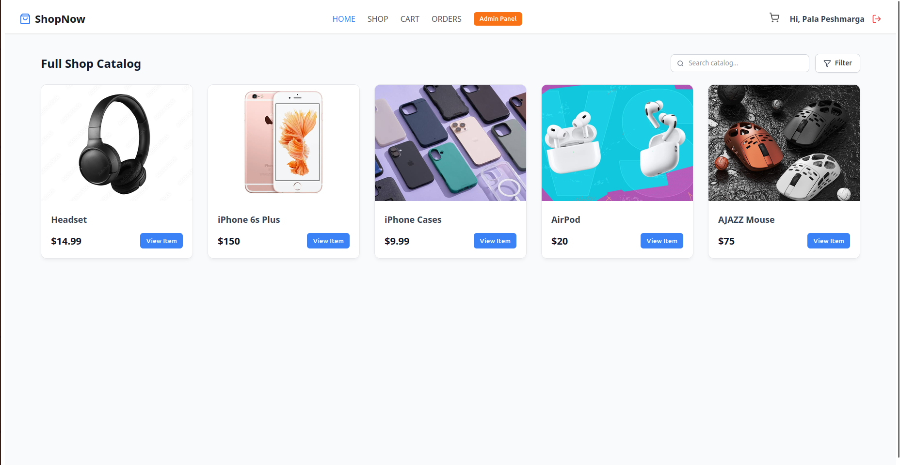
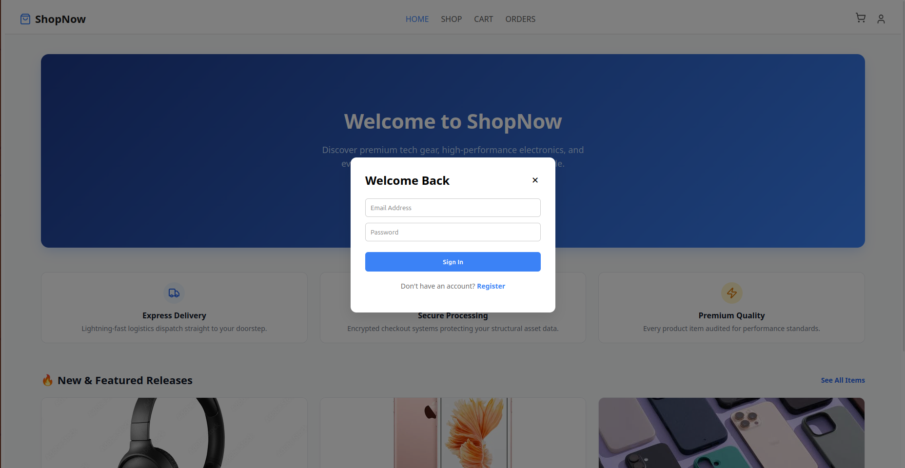
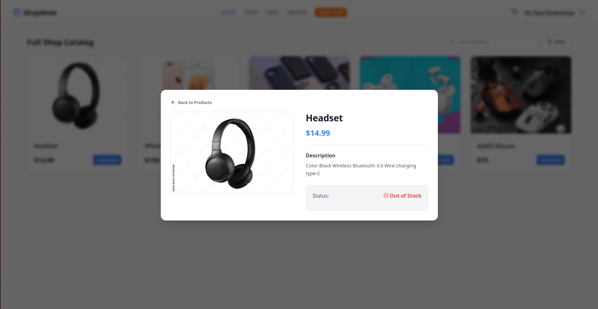
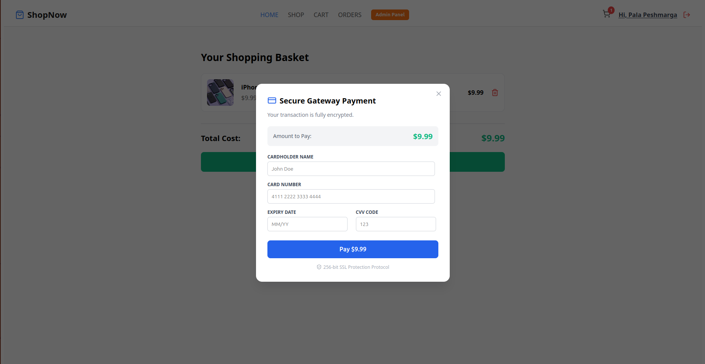
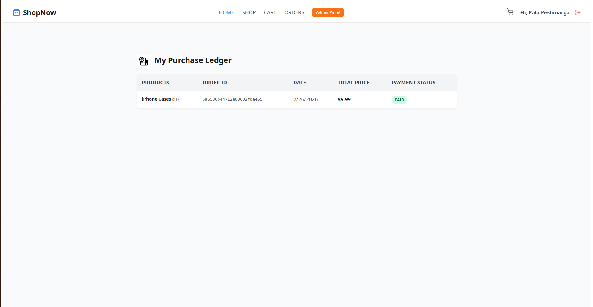

# ShopNow

ShopNow is a full-stack electronics storefront built with React, Vite, Express, and MongoDB. Customers can browse products, create an account, manage a shopping cart, complete a simulated checkout, and review past orders. Authenticated administrators can manage products, users, and orders through the admin dashboard.

## Features

- Product catalog with search, filtering, and product details
- User registration, login, profile management, and JWT authentication
- Shopping cart with checkout and order creation
- Customer order history
- Admin dashboard for products, users, and orders
- Express API backed by MongoDB
- Responsive storefront UI

## Tech stack

- Frontend: React 18, Vite, Axios, React Router, Lucide React
- Backend: Node.js, Express, Mongoose, JSON Web Token, bcryptjs
- Database: MongoDB

## Project structure

```text
ShopNow/
├── backend/
│   ├── models/          # User, product, and order schemas
│   ├── routes/          # REST API routes
│   ├── middleware/      # Authentication and authorization
│   └── server.js
├── frontend/
│   └── src/
│       ├── components/  # Storefront, account, cart, and admin UI
│       ├── context/     # Cart state
│       └── api/         # Axios API client
└── docs/screenshots/    # Project screenshots
```

## Requirements

- Node.js 18 or newer
- npm
- A MongoDB database, local or hosted

## Getting started

Clone or open the project, then install dependencies in both packages:

```bash
cd backend
npm install

cd ../frontend
npm install
```

Create `backend/.env` with the following variables:

```env
PORT=5000
MONGO_URI=mongodb://127.0.0.1:27017/shopnow
JWT_SECRET=replace-with-a-long-random-secret
NODE_ENV=development
```

Start the backend in one terminal:

```bash
cd backend
npm start
```

Start the frontend in another terminal:

```bash
cd frontend
npm run dev
```

Open [http://localhost:5173](http://localhost:5173) in a browser. The frontend API client expects the backend at `http://localhost:5000/api`.

## Production build

Build the frontend with:

```bash
cd frontend
npm run build
```

The backend is configured to serve the generated `frontend/dist` files when running in a production-style setup.

## API overview

The backend exposes these main route groups:

| Route | Purpose |
| --- | --- |
| `GET /api/products` | List products |
| `/api/users` | Register, log in, and manage users |
| `/api/orders` | Create and view orders |
| `/api/products` | Admin product management |

Protected operations require the JWT returned during login.

## Screenshots

### Product catalog



### Authentication



### Store views







## Notes

- Keep `backend/.env` private and do not commit database credentials or JWT secrets.
- Checkout is currently a simulated payment flow; it records an order after the client-side payment simulation completes.
- No automated test suite is currently configured; use `npm run lint` and `npm run build` in `frontend` for basic validation.
